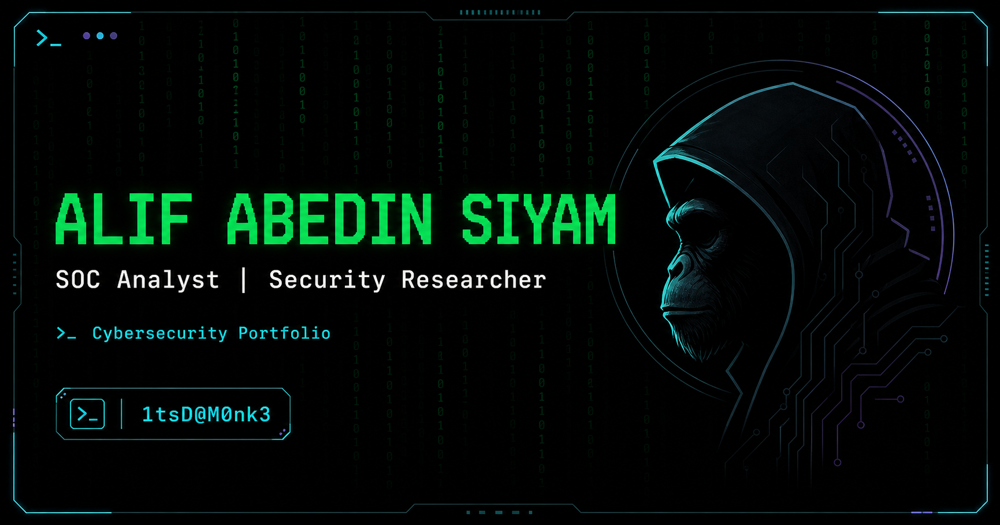

# Alif Abedin Siyam — Cybersecurity Portfolio

[](https://alifabedinsiyam.vercel.app)

Portfolio of **Alif Abedin Siyam**, a SOC Analyst, Security Researcher, and aspiring Penetration Tester. The site presents verified project work, categorized security writeups, credentials, capabilities, and a server-authoritative terminal CTF while preserving its original binary-rain and terminal-inspired identity.

[Visit the portfolio](https://alifabedinsiyam.vercel.app) · [LinkedIn](https://www.linkedin.com/in/alif-abedin-siyam/) · [Medium](https://medium.com/@siyam.exe) · [GitHub](https://github.com/siyam-exe)



## What is included

- Recruiter-focused landing page with verified profile and work highlights.
- About page with education, credentials, security tools, programming languages, experience, and interests.
- Cybersecurity Homelab project report linked to its public source repository.
- Thirty categorized CTF and security writeups rendered from Markdown.
- Contact form protected by server validation, Cloudflare Turnstile, honeypot checks, and Upstash rate limiting.
- Interactive terminal for navigation, site information, and one five-chapter CTF.
- Route-specific metadata, structured data, sitemap, robots directives, social cards, and accessible 404/error states.
- Responsive navigation, keyboard support, reduced-motion behavior, and automated accessibility checks.

## Featured project

### Cybersecurity Homelab

A personal SOC-style lab that generates controlled attacks against isolated vulnerable targets, traces the resulting telemetry through Wazuh SIEM, and turns it into a documented investigation workflow.

The project covers:

- Wazuh SIEM and log ingestion
- Suricata network telemetry
- DVWA, OWASP Juice Shop, and Metasploitable test targets
- Custom detections and alert correlation
- Four SOC investigation dashboards
- Operations, validation, backups, health checks, and documentation

[View the homelab repository](https://github.com/siyam-exe/cybersecurity-homelab)

## Writeup library

The writeup library is organized by security domain rather than by publication schedule:

- Cryptography
- OSINT
- Forensics
- Privilege escalation
- Web exploitation
- Binary exploitation
- Reverse engineering

Each article is stored as Markdown with local evidence images and is available through a stable route under `/writeups`.

## Terminal and CTF

The terminal is available from every route and supports navigation, profile information, project discovery, and the **Last Peel of Sunroot Grove** challenge.

The CTF is deliberately separated across terminal commands, a real writeup, project evidence, response metadata, and a robots-discovered endpoint. Progress and final submissions are validated by the server using short-lived signed sessions. The challenge is recreational and does not protect private or administrative data.

No solution or flag is included in this README.

## Technology

- Next.js 15
- React 19
- TypeScript
- Tailwind CSS 4
- React Markdown and remark-gfm
- Vercel Speed Insights
- Playwright, axe-core, CodeQL, and Gitleaks

The repository uses pnpm only. Versions are pinned through `package.json` and `pnpm-lock.yaml`.

## Local development

### Requirements

- Node.js 20.9 or newer
- pnpm 10.20.0

### Setup

```bash
git clone https://github.com/siyam-exe/Cybersecurity-Portfolio.git
cd Cybersecurity-Portfolio
pnpm install --frozen-lockfile
```

Copy `.env.example` to `.env.local` and provide the services needed for the features you want to exercise. Never commit `.env.local`.

```bash
pnpm dev
```

Open [http://localhost:3000](http://localhost:3000).

## Environment variables

| Variable | Purpose | Exposure |
|---|---|---|
| `EMAILJS_SERVICE_ID` | EmailJS delivery service | Server only |
| `EMAILJS_TEMPLATE_ID` | EmailJS message template | Server only |
| `EMAILJS_PUBLIC_KEY` | EmailJS API identity | Server route |
| `EMAILJS_PRIVATE_KEY` | Optional EmailJS private authentication | Secret |
| `NEXT_PUBLIC_TURNSTILE_SITE_KEY` | Turnstile widget site key | Public |
| `TURNSTILE_SECRET_KEY` | Server-side CAPTCHA verification | Secret |
| `UPSTASH_REDIS_REST_URL` | Durable rate-limit store | Secret |
| `UPSTASH_REDIS_REST_TOKEN` | Durable rate-limit authentication | Secret |
| `RATE_LIMIT_SALT` | Hashes client identifiers before storage | Secret |
| `NEXT_PUBLIC_GOOGLE_SITE_VERIFICATION` | Google Search Console verification | Public |
| `CTF_SIGNING_SECRET` | Signs CTF session state | Secret |
| `CTF_RUNE_WORD` | Server-side CTF derivation value | Secret |

Production contact requests fail closed when Turnstile, durable rate limiting, or the hashing salt is unavailable. Secret values must remain in the deployment environment and must never use the `NEXT_PUBLIC_` prefix.

## Verification

Run the project checks:

```bash
pnpm install --frozen-lockfile
pnpm audit
pnpm typecheck
pnpm lint
pnpm build
pnpm exec playwright install chromium
pnpm test:e2e
```

The browser suite covers public routes, accessibility, metadata, structured data, crawl files, links, mobile navigation, terminal behavior, CTF progress and tamper rejection, contact rejection paths, and unknown-writeup 404 handling.

## Content import

The current writeup library is already committed. To rebuild it from the source archive:

```bash
pnpm writeups:import -- "C:\path\to\writeup-source"
```

Review the resulting Markdown, metadata, image references, and Git diff before committing imported content.

## Security and privacy

- Contact submissions are processed through a server endpoint.
- Requests are validated for origin, content type, size, field format, consent, honeypot state, CAPTCHA, and rate limits.
- Rate-limit identifiers are salted hashes rather than raw client addresses.
- Security headers include CSP, HSTS, frame denial, content-type protection, a restrictive referrer policy, and a permissions policy.
- CTF progress is HMAC-signed and tampered state is rejected.
- The verification suite covers dependency, type, lint, build, browser, accessibility, and secret checks.

Report a security or privacy concern through the [portfolio contact page](https://alifabedinsiyam.vercel.app/contact). Do not include credentials, tokens, or sensitive personal data in a public GitHub issue.

## Deployment

The production site is hosted on Vercel and connected to the repository’s `master` branch. Updates to `master` are deployed automatically.

## License

Copyright © Alif Abedin Siyam. All rights reserved. See [LICENSE](LICENSE).
